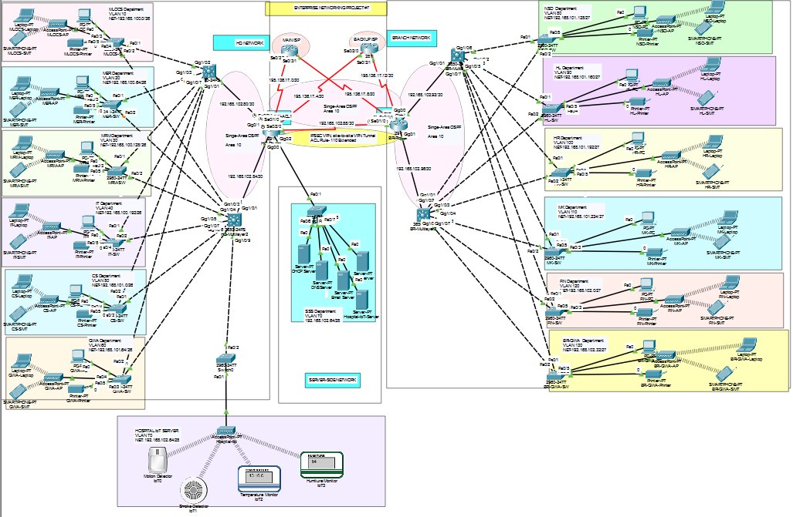
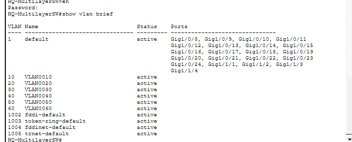
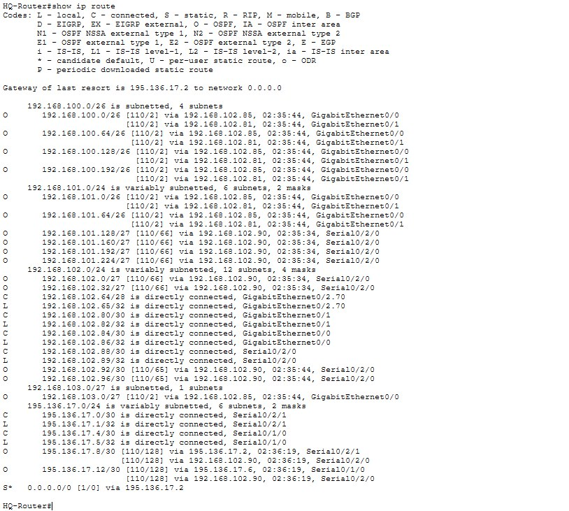
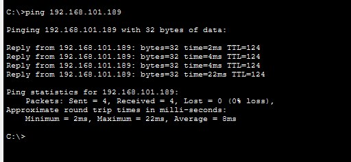

# Hospital Management Network (Cisco Packet Tracer)

A secure hospital network design with VLAN segmentation, inter-VLAN routing, and a site-to-site IPsec VPN.

## Network Topology

## Features
- VLANs 10 to 60 on a multilayer switch (`HQ-MultilayerSW`)
- Inter-VLAN routing
- Site-to-site IPsec VPN (`HQ-Router`)
- [Add others you used: DHCP, OSPF, ACLs, NAT, etc.]

## VLAN Plan
| VLAN | Department |
|---|---|
| 10 | [e.g. Reception] |
| 20 | [e.g. Doctors] |
| 30 | [e.g. Pharmacy] |
| 40 | [e.g. Servers] |
| 50 | [e.g. Admin] |
| 60 | [e.g. Guest] |

## Test Results

### VLAN Configuration

All VLANs are created and active on the multilayer switch.

### VPN Tunnel Status

The IPsec tunnel is up (`QM_IDLE`, `ACTIVE`).

### Connectivity Tests

Pings across the network reply with 0% packet loss.

## How to Open
Open the `.pkt` file with Cisco Packet Tracer 8.x.

## What I Learned
[Write 2 or 3 sentences about what you learned.]