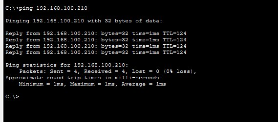

# Hospital Management Network (Cisco Packet Tracer)

An enterprise-style hospital network with a Headquarters (HQ), a Branch Clinic, a Server Farm, and a wireless IoT ward-monitoring system. It uses VLAN segmentation, inter-VLAN routing, OSPF, dual-ISP failover, and a site-to-site IPsec VPN.

## Network Topology

## Features
- **VLANs 10 to 140** for HQ, Branch, Server Farm, and IoT, using 802.1Q trunking
- **Inter-VLAN routing** with SVIs on dual multilayer switches at HQ and Branch
- **DHCP relay** (`ip helper-address`) to a central DHCP server
- **OSPF** (Process 10, Area 0) for dynamic routing between sites
- **Dual-ISP failover** using floating static default routes
- **Site-to-site IPsec VPN** between HQ-Router and BR-Router (AES-256, DH Group 5, pre-shared key)
- **NAT/PAT overload** for internet access
- **Layer 2 security:** PortFast, BPDU Guard, and port security with sticky MAC addresses
- **Central servers:** DHCP, DNS, Email, Web, and IoT
- **Wireless IoT monitoring:** smoke, temperature, humiture, and motion sensors
- **Hospital web portal:** home, doctors, appointments, patient services, and live IoT status pages

## Devices
| Type | Devices |
|---|---|
| Edge routers | Cisco 2911 (HQ-Router, BR-Router) |
| ISP routers | Cisco 2811 (Main ISP, Backup ISP) |
| Core switches | Layer 3 multilayer switches (HQ-MultilayerSW 1 and 2, BR-MultilayerSW 1 and 2) |
| Access switches | Cisco 2960-24TT (one per department) |
| Servers | DHCP, DNS, Email, Web, IoT |
| IoT | Smoke detector, motion detector, temperature sensor, humiture sensor, access point |

## VLAN Plan
| VLAN | Department | Site | Subnet |
|---|---|---|---|
| 10 | Medical Locs (MLOCS) | HQ | 192.168.100.0/26 |
| 20 | Medical Emergency Room (MER) | HQ | 192.168.100.64/26 |
| 30 | Medical Records Management (MRM) | HQ | 192.168.100.128/26 |
| 40 | IT Department | HQ | 192.168.100.192/26 |
| 50 | Clinical Surgery (CS) | HQ | 192.168.101.0/26 |
| 60 | General Ward A (GWA) | HQ | 192.168.101.64/26 |
| 70 | Server Farm (SSS) | HQ | 192.168.102.64/28 |
| 80 | Nursing Office (NSO) | Branch | 192.168.101.128/27 |
| 90 | Health Lab (HL) | Branch | 192.168.101.160/27 |
| 100 | HR | Branch | 192.168.101.192/27 |
| 110 | Marketing (MK) | Branch | 192.168.101.224/27 |
| 120 | Finance (FIN) | Branch | 192.168.102.0/27 |
| 130 | General Ward (BRA-GWA) | Branch | 192.168.102.32/27 |
| 140 | Hospital IoT | HQ | 192.168.103.0/27 |

The IP plan uses VLSM to avoid wasting addresses.

## Key Configuration

**IPsec VPN (HQ-Router to BR-Router):** ISAKMP Phase 1 with AES-256, pre-shared authentication, and DH Group 5. Phase 2 uses an ESP transform set (`esp-aes`, `esp-sha-hmac`) and a crypto map bound to the serial interface.

**WAN failover:** the primary default route points to the Main ISP, and a floating static route (administrative distance 70) points to the Backup ISP.

**Full device configs:** see [router-config.txt](router-config.txt) and [switch-config.txt](switch-config.txt).

## Test Results

### VLAN Configuration

All VLANs are created and active on the HQ multilayer switch.

### VPN Tunnel Status

`show crypto isakmp sa` on HQ-Router shows the IPsec tunnel to the branch is up (`QM_IDLE`, `ACTIVE`).

### Connectivity Tests

Ping to a host in VLAN 40 (IT Department): 0% packet loss.

Ping to a host in VLAN 90 (Branch Health Lab) across sites: 0% packet loss.

Other verified results:
- Clients in all VLANs receive IP addresses from the central DHCP server
- All 4 IoT sensors get DHCP addresses (192.168.103.x) and register with the IoT server
- Hospital web portal opens from department PCs at `http://192.168.102.70`

## How to Open
Open the `.pkt` file with Cisco Packet Tracer 8.x or newer.

## Limitations and Future Work
- Built and tested in simulation only
- IoT wireless access point uses open authentication (WPA3-Enterprise with 802.1X/RADIUS planned)
- No first-hop redundancy yet (HSRP/VRRP planned for the dual core switches)
- Planned: QoS for critical traffic and IPv6 dual-stack

## What I Learned
This project taught me how to design a multi-site network from scratch: planning subnets with VLSM, segmenting departments with VLANs, routing between sites with OSPF, and securing traffic with an IPsec VPN and Layer 2 port security. I also learned how to troubleshoot with `show` commands and ping tests, and how to add redundancy with dual ISPs and dual core switches.
